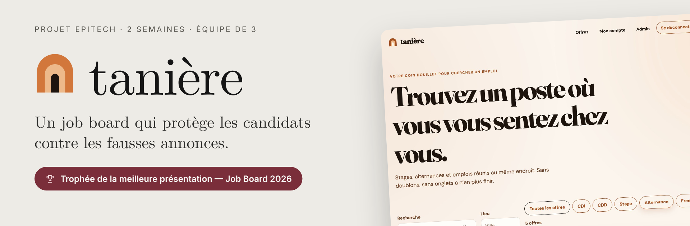
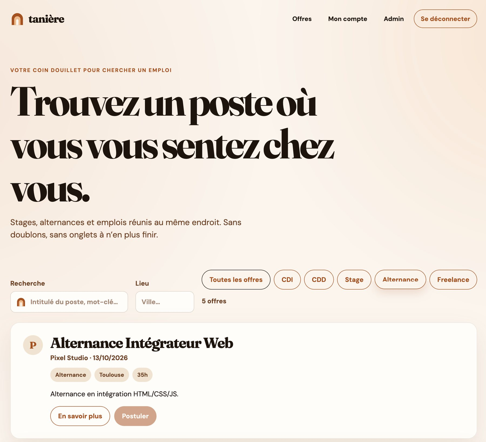
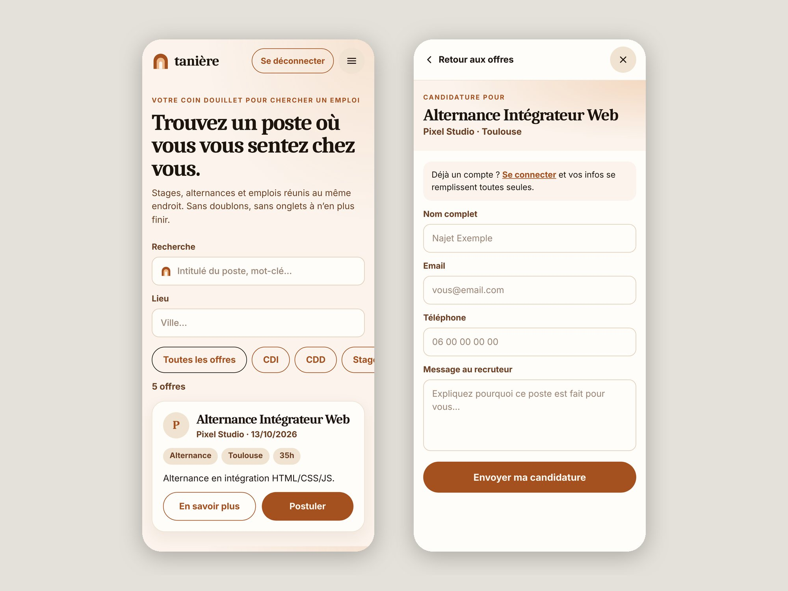
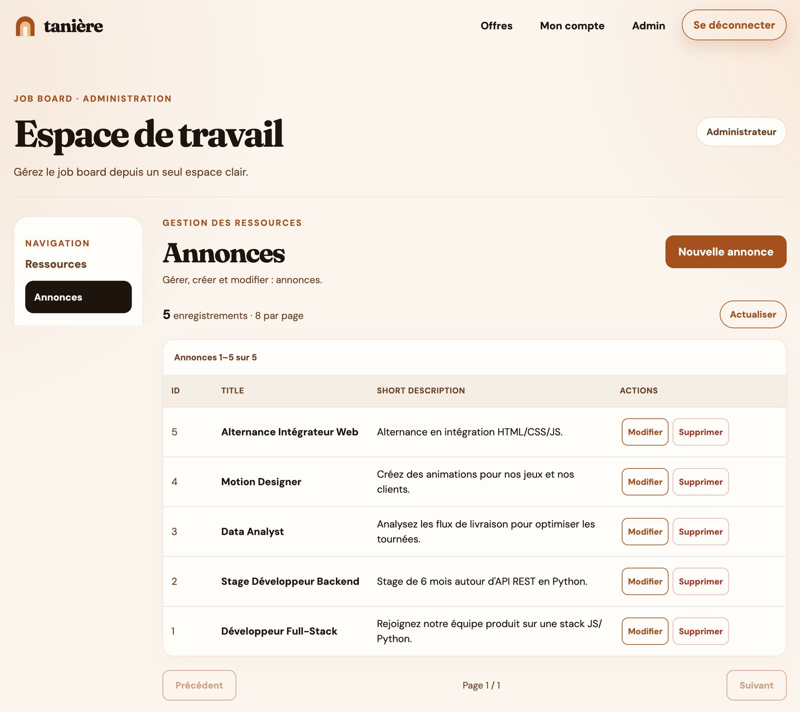
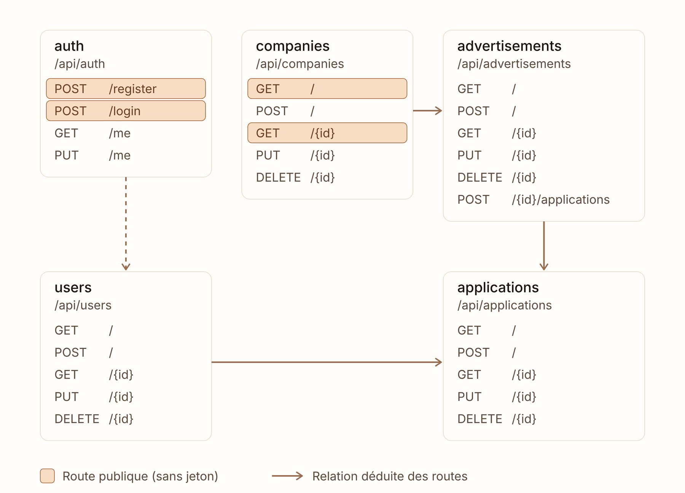

<p align="center">
  
</p>

<p align="center">
  
  
  
  
  
  
</p>

> Projet pédagogique Epitech réalisé **en 2 semaines, en équipe de 3**, pendant la piscine.
> 🏆 **Trophée de la meilleure présentation — Job Board 2026.**
> Les comptes et les annonces préchargés sont fictifs : ce sont des données de démonstration.

## Le projet

**tanière** est un site d'offres d'emploi de tous types (CDI, CDD, stage, alternance…), pas uniquement destiné aux étudiants.
Notre priorité : **protéger les candidats contre les fausses annonces**.

Le nom vient de nos trois initiales (**T**eikinui, **A**ntonin, **N**ajet) : la tanière, c'est le refuge, l'endroit où l'on se sent chez soi.
D'où notre phrase d'accroche : *« Trouvez un poste où vous vous sentez chez vous. »*

## L'application en images

| | |
| :---: | :---: |
|  |  |
| **Accueil** · recherche par mot-clé, lieu et contrat | **Mobile** · liste des offres et candidature |
|  |  |
| **Espace administrateur** · gestion des annonces | **API REST** · les routes du serveur |

## Fonctionnalités

- **Recherche d'offres** par mot-clé, lieu et type de contrat, avec pagination
- **Candidature** en quelques clics, avec ou sans compte
- **Compte candidat** : inscription, connexion, coordonnées modifiables
- **Espace administrateur** : gestion des annonces, des entreprises, des utilisateurs et des candidatures
- **Sécurité** : mots de passe chiffrés (bcrypt), authentification par jeton (JWT), limitation du nombre de tentatives de connexion

## L'équipe

| | Rôle |
| --- | --- |
| **Najet Zridette** | Direction artistique et web design : maquette Figma, identité visuelle, CSS |
| **Antonin Chevolleau** | Développement |
| **Teikinui Decian** | Développement |

## Stack technique

| Partie | Technologies |
| --- | --- |
| Interface | React 19, React Router 7, Vite 8 |
| Serveur | FastAPI, SQLAlchemy 2, PyJWT, bcrypt |
| Base de données | MySQL 8 |
| Design | Figma |

## Lancer le projet en local

Prérequis : Python 3.12+, Node.js 22.12+, MySQL 8.

```bash
# 1. Base de données
mysql -u <user> -p -e "CREATE DATABASE job_board CHARACTER SET utf8mb4;"
mysql -u <user> -p job_board < backend/sql/schemas.sql
mysql -u <user> -p job_board < backend/sql/seed.sql

# 2. Serveur (terminal 1)
cd backend
python3 -m venv .venv && source .venv/bin/activate
pip install -r requirements.txt
cp .env.example .env    # renseigner DATABASE_URL et SECRET_KEY
python -m uvicorn app.main:app --reload --port 8000

# 3. Interface (terminal 2)
cd frontend
npm install
npm run dev             # puis ouvrir http://localhost:5173
```

Comptes de démonstration (mot de passe `admin1234`) : `admin`, `recruiter`, `jdoe`.

---

<p align="center">
  Dépôt d'équipe d'origine : <a href="https://github.com/antonin-chevolleau/job-board-epitech">antonin-chevolleau/job-board-epitech</a><br>
  <a href="https://najetzridette.github.io">Mon portfolio</a> · <a href="https://www.linkedin.com/in/najet-zridette">LinkedIn</a>
</p>
